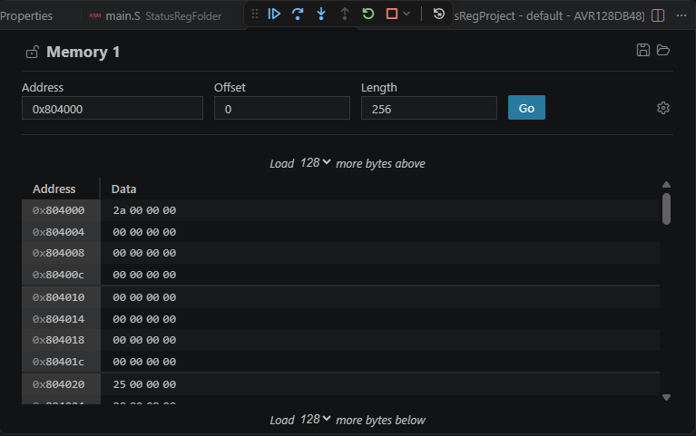

# AVR128DB48 Assembly Projects

A collection of embedded systems projects using AVR Assembly, developed as part of my Electronics Engineering studies at Hochschule Hamm-Lippstadt (HSHL), Germany.

## Overview

This repository demonstrates practical skills in microcontroller programming, CPU architecture, arithmetic operations, memory access and embedded systems debugging.

## Development Environment

| Component | Technology |
|---|---|
| Microcontroller | AVR128DB48 |
| Programming Language | AVR Assembly |
| IDE | Visual Studio Code |
| Development Tools | MPLAB |
| Testing Environment | MPLAB Simulator |

## Projects

| Project | Description | Status |
|---|---|---|
| [01 – Status Register](Task-01-Status-Register/) | Arithmetic operations, SREG flags and SRAM memory access | Simulator verified |
| 02 – Sum Program | Addition operations and memory storage | Planned |

## Featured Project

### Task 01 – Status Register and SRAM Operations

This project demonstrates two subtraction operations, analysis of the AVR Status Register and direct SRAM memory access.

**Verified results:**

- First subtraction: 0x34 - 0x25 = 0x0F
- Second subtraction: 0x2A - 0x05 = 0x25
- Status Register: 0x20 and 0x00
- Final result stored at SRAM address 0x4020

[View full project documentation and source code](Task-01-Status-Register/)

## Technical Skills

- AVR Assembly programming
- Microcontroller architecture
- CPU register and status flag analysis
- SRAM memory operations
- Embedded systems debugging
- Simulation-based testing

## About Me

Electronics Engineering student at Hochschule Hamm-Lippstadt, interested in embedded systems, microcontrollers and hardware development.

## Repository Structure

Each project contains its own Assembly source code, technical documentation and simulation results.
