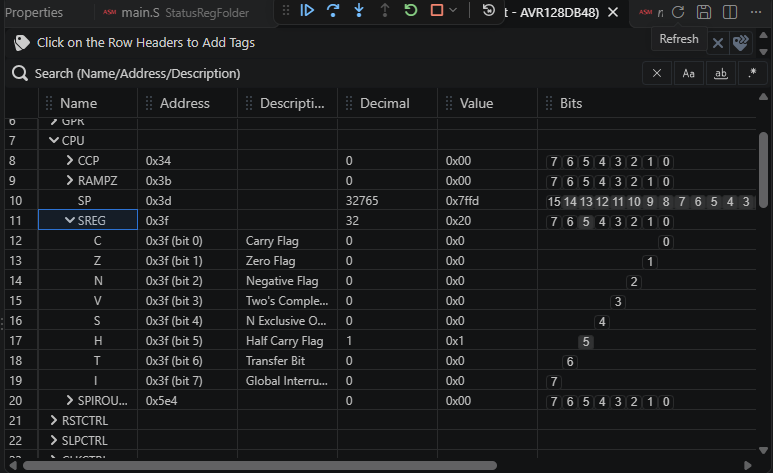
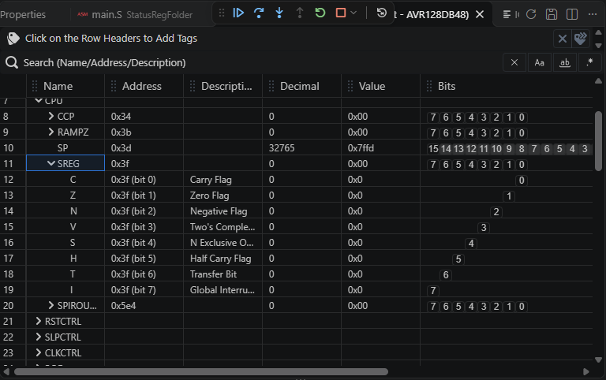
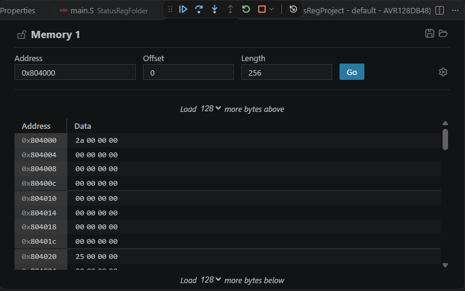

# AVR128DB48 – Status Register and SRAM Operations

## Project Overview

This project demonstrates low-level Assembly programming on the AVR128DB48 microcontroller, focusing on arithmetic operations, CPU status flags and direct SRAM memory access.

## Development Environment

- **Microcontroller:** AVR128DB48
- **Language:** AVR Assembly
- **IDE:** Visual Studio Code with MPLAB
- **Testing:** MPLAB Simulator

## Source Code

[View Assembly source code](main.S)

## Simulation Results

### 1. First Subtraction

The program subtracts 0x25 from 0x34.

| Register | Value |
|---|---|
| R20 (initial) | 0x34 (52) |
| R21 | 0x25 (37) |
| R20 (result) | 0x0F (15) |
| SREG | 0x20 |

The Half Carry flag is set because the subtraction of the lower four bits requires a borrow.

### 2. Second Subtraction

The program loads a value from SRAM and subtracts 5 from it.

| Register | Value |
|---|---|
| Initial value | 0x2A (42) |
| R16 | 0x05 (5) |
| R0 (result) | 0x25 (37) |
| SREG | 0x00 |

The Half Carry flag is cleared because no half borrow is required.

### 3. SRAM Memory Verification

The Memory Inspector confirms that both values are correctly stored in SRAM.

| SRAM Address | Hexadecimal | Decimal |
|---|---|---|
| 0x4000 | 0x2A | 42 |
| 0x4020 | 0x25 | 37 |

## Key Assembly Instructions

| Instruction | Function |
|---|---|
| LDI | Load an immediate value |
| SUB | Subtract register values |
| LDS | Load data from data memory |
| STS | Store data in data memory |
| RJMP | Relative jump |

## Skills Demonstrated

- AVR Assembly programming
- Embedded systems debugging
- CPU register analysis
- Status register interpretation
- SRAM memory operations
- Simulation-based verification

## Conclusion

The program was successfully built and tested using the AVR128DB48 simulator. Both subtraction operations, the corresponding status flags and the final SRAM values were verified.

Completed as part of Embedded Systems coursework at Hochschule Hamm-Lippstadt (HSHL).
