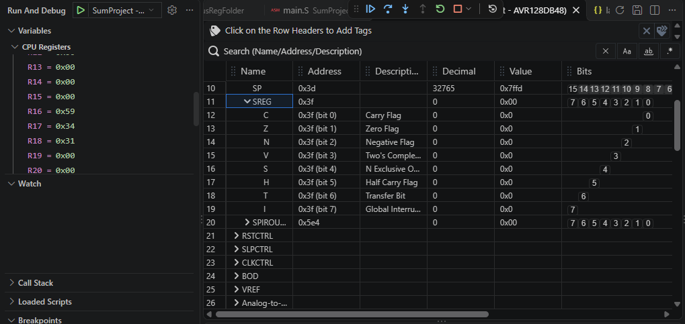
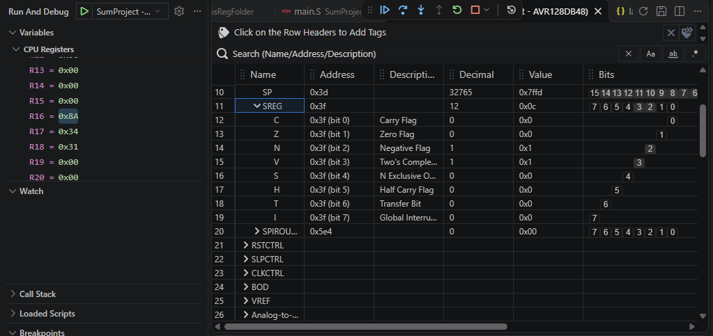
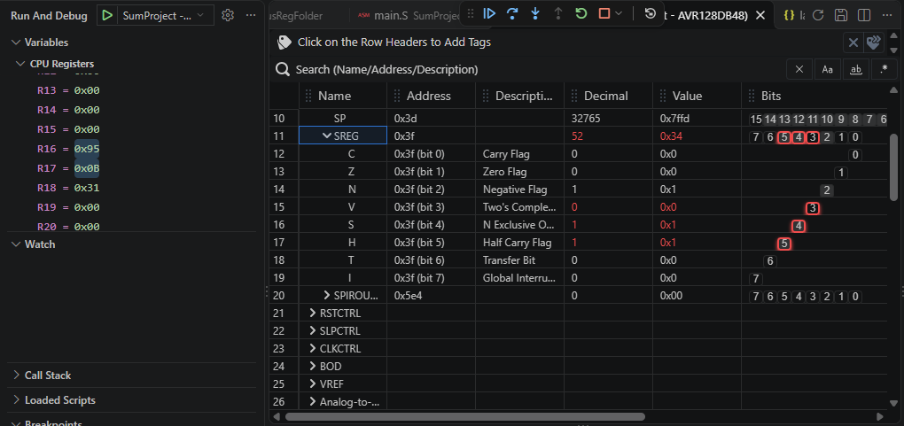
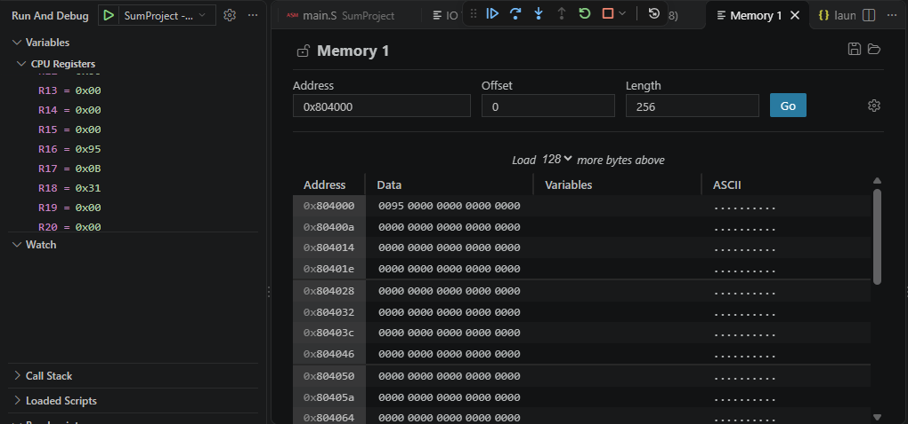
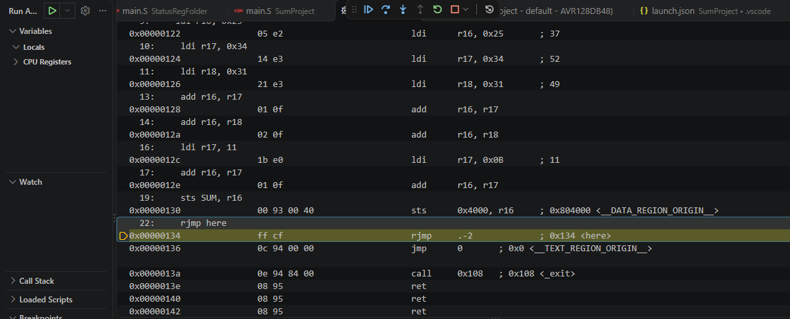

# AVR128DB48 – Sum Program and Machine-Code Analysis

## Project Overview

This project demonstrates arithmetic operations, CPU status register analysis, SRAM memory access, and machine-code inspection using the AVR128DB48 microcontroller.

The program calculates the sum of four 8-bit values using AVR Assembly, analyzes the CPU status flags after each addition, and stores the final result in SRAM.

The program was developed and tested using the MPLAB Simulator in Visual Studio Code.

## Development Environment

| Component | Technology |
|---|---|
| Microcontroller | AVR128DB48 |
| Programming Language | AVR Assembly |
| IDE | Visual Studio Code |
| Development Tools | MPLAB |
| Testing Environment | MPLAB Simulator |
| Debugging Tools | CPU Registers, I/O View, Memory Inspector, Disassembly View |

## Project Objectives

- Implement arithmetic operations using AVR Assembly.
- Understand the accumulator-based addition process.
- Analyze the AVR Status Register (SREG).
- Investigate signed overflow and unsigned arithmetic.
- Store calculated results in SRAM.
- Inspect Assembly instructions and their machine-code representations.
- Verify program behavior using simulator breakpoints.

## Source Code

[View Assembly source code](main.S)

## Program Operation

The program adds four values:

| Value | Hexadecimal | Decimal |
|---|---|---|
| First | 0x25 | 37 |
| Second | 0x34 | 52 |
| Third | 0x31 | 49 |
| Fourth | 0x0B | 11 |
| Final Sum | 0x95 | 149 |

Register R16 is used as an accumulator throughout the program.

The final result is stored at SRAM address 0x4000 using the STS instruction.

## Simulation Results

### 1. First Addition

The first addition calculates:

37 + 52 = 89

| Register | Value |
|---|---|
| R16 | 0x59 |
| R17 | 0x34 |
| R18 | 0x31 |
| SREG | 0x00 |

No arithmetic status flags are set because the result does not cause a carry, half carry, negative result, or signed overflow.

### 2. Second Addition

The second addition calculates:

89 + 49 = 138

| Register | Value |
|---|---|
| R16 | 0x8A |
| R17 | 0x34 |
| R18 | 0x31 |
| SREG | 0x0C |

The Negative (N) and Overflow (V) flags are set.

The unsigned result is 138, which exceeds the maximum signed 8-bit value of 127.

The Carry flag remains clear because the result does not exceed the unsigned 8-bit limit of 255.

### 3. Third Addition

The third addition calculates:

138 + 11 = 149

| Register | Value |
|---|---|
| R16 | 0x95 |
| R17 | 0x0B |
| R18 | 0x31 |
| SREG | 0x34 |

The Half Carry (H), Sign (S), and Negative (N) flags are set.

The Half Carry flag is set because the addition of the lower four bits produces a carry.

The Overflow flag is cleared because the signed operation -118 + 11 = -107 remains within the signed 8-bit range.

## Status Register Analysis

| Operation | Result | H | S | V | N | Z | C | SREG |
|---|---|---|---|---|---|---|---|---|
| First Addition | 0x59 | 0 | 0 | 0 | 0 | 0 | 0 | 0x00 |
| Second Addition | 0x8A | 0 | 0 | 1 | 1 | 0 | 0 | 0x0C |
| Third Addition | 0x95 | 1 | 1 | 0 | 1 | 0 | 0 | 0x34 |

### Status Flag Definitions

| Flag | Description |
|---|---|
| H | Half Carry |
| S | Sign |
| V | Two's Complement Overflow |
| N | Negative |
| Z | Zero |
| C | Carry |

## SRAM Memory Verification

The final sum is stored in SRAM using:

`sts SUM, r16`

The symbolic constant SUM represents memory address 0x4000.

| Parameter | Value |
|---|---|
| Final result | 149 |
| Hexadecimal result | 0x95 |
| SRAM address | 0x4000 |
| Debugger memory address | 0x804000 |

The Memory Inspector confirms that the final result is correctly stored in SRAM.

## Machine-Code Analysis

The Disassembly View was used to inspect the machine-code representation of the Assembly instructions.

| Assembly Instruction | Machine-Code Word | Size |
|---|---|---|
| ldi r16, 0x25 | E205 | 2 bytes |
| ldi r17, 0x34 | E314 | 2 bytes |
| ldi r18, 0x31 | E321 | 2 bytes |
| add r16, r17 | 0F01 | 2 bytes |
| add r16, r18 | 0F02 | 2 bytes |
| ldi r17, 11 | E01B | 2 bytes |
| add r16, r17 | 0F01 | 2 bytes |
| sts 0x4000, r16 | 9300 4000 | 4 bytes |
| rjmp here | CFFF | 2 bytes |

The Assembly program contains nine instructions occupying a total of 20 bytes of program memory, excluding compiler-generated startup code.

The AVR architecture stores instruction words in little-endian byte order.

## Key Assembly Instructions

| Instruction | Function |
|---|---|
| LDI | Load an immediate value into a CPU register |
| ADD | Add two register values |
| STS | Store a register value in data memory |
| RJMP | Perform a relative jump |
| EQU | Define a symbolic constant |

## Skills Demonstrated

- AVR Assembly programming
- Microcontroller architecture
- Arithmetic and accumulator operations
- Signed and unsigned number representation
- CPU status flag analysis
- SRAM memory access
- Machine-code interpretation
- Embedded systems debugging
- Simulation-based testing and verification

## Conclusion

The Sum Program was successfully built and executed using the AVR128DB48 simulator.

The program calculated the expected result of 149 (0x95), demonstrated the corresponding CPU status flag changes, and stored the final value at SRAM address 0x4000.

The Disassembly View was also used to analyze instruction encoding and program memory usage.

This project was completed as part of Embedded Systems coursework at Hochschule Hamm-Lippstadt (HSHL), Germany.

## Testing Status

Simulator tested and verified.

Physical hardware testing has not been performed for this project.
